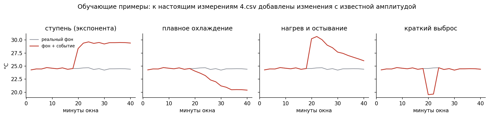
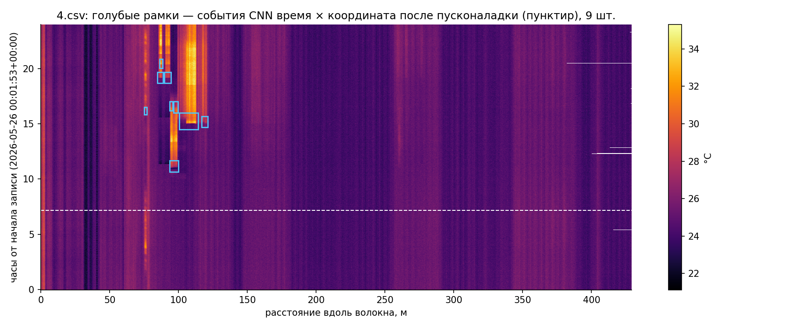
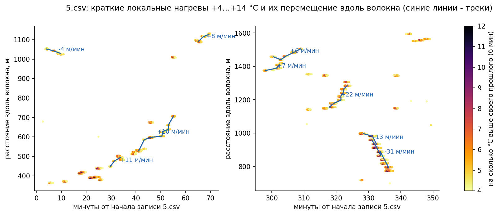

# FiberWatch: обнаружение температурных событий по данным распределённого волоконного сенсора

Кейс МГТС «Анализ данных распределённых волоконных сенсоров».

## Итог

- **Решение — один файл `fiberwatch.py`**: CSV → проверка качества → окна → свёрточная нейросеть → правило уведомления → события для оператора. Полное обучение — около 50 минут на обычном процессоре.
- **Как принимается решение.** Нейросеть (9 соседних точек волокна за 40 минут) отвечает на вопрос «похоже ли это на событие». Правило отвечает на вопрос «достаточно ли оно велико»: изменение ≥ 3 °C и от начала окна, и от обычного фона до него. Уведомление — только когда «да» на оба вопроса.
- **Реальная запись:** 81 из 81 уведомления верные — **100 %** (95 % ДИ 95,5–100 %), по слепой разметке 192 случаев. Каждую запись просматривала модель, которая этот прибор не видела.
- **Искусственные события на приборе, которого не было в обучении:** найдено **99,1 %**, верных тревог **94,3 %**, тревоги на одноточечных сбоях прибора — **2,0 %**.
- **Прогноз:** если изменение уже началось и растёт, система заранее пишет, через сколько минут оно превысит порог; для 23 % событий — за 10 минут и раньше.
- **Второй этап — класс события:** тип, длительность, протяжённость, повтор и периодичность, одновременность, пульсация — по явным признакам; проверено на подмешанных событиях с известным ответом.
- **Исследовательская часть:** **нагревы, движущиеся вдоль волокна**, со скоростью и направлением.

## 1. Что выдаёт система

| Ситуация | Ответ системы |
|---|---|
| Изменение ≥ 3 °C (на шумном приборе ≥ 4 × шум) и от начала окна, и от обычного фона до него | событие: тип и класс — **требуется проверка** |
| Модель видит событие, но изменение от фона меньше порога | кандидат, без уведомления |
| Изменение уже ≥ 1 °C от фона и растёт к порогу | прогноз, без уведомления |
| Медленное изменение ≥ 3 °C за 2 часа | журнал медленных изменений, без уведомления |
| Выброс в одной точке на один замер, соседи и следующий замер в норме | **вероятный сбой измерения** — сообщение о качестве данных |
| Всё волокно разом сдвинулось на один или несколько профилей | **общий сдвиг прибора** — вычитается до анализа, сообщение о качестве |
| Значение ниже −273,15 °C | недостоверные данные |
| Причина изменения | не определяется: по одной температуре её не установить |

3 °C — порог уведомления, выбранный командой.

## 2. Данные

| Файл | Прибор (`dts_id`) | Профилей | Точек | Длина, м | Период | Шаг | Особенности |
|---|---|---:|---:|---:|---|---|---|
| 1.csv | 0e0d0f3c… | 615 | 11 707 | 1 188 | 14.09.2026, 12 ч, UTC+3 | 30 с / 4 мин | «живой» объект: 12,9…56,3 °C; 79 общих сдвигов всего волокна |
| 2.csv | cd477c43… кан. 1 | 696 | 2 315 | 587 | 10.04.2026, сутки, UTC | 2 мин | 14 неполных профилей |
| 3.csv | cd477c43… кан. 2 | 788 | 1 689 | 428 | 12–13.02.2026, UTC | 2 мин | разрыв 21 ч 25 мин |
| 4.csv | cd477c43… кан. 2 | 708 | 1 691 | 429 | 26.05.2026, сутки, UTC | 2 мин | 10 неполных профилей |
| 5.csv | mapping_ch02 | 2 711 | 2 364 | 2 363 | 16.10.2025, 9 ч, пояс не указан | 10 с | −300 °C на 675 точках (1 689–2 363 м); сильный шум |
| 6.csv | 5f895b10… | 1 231 | 4 534 | 1 150 | 12.02.2026, сутки, UTC+3 | 1 мин | разрыв 3 ч 21 мин, 108 неполных профилей |

Всего 6 749 профилей и 23,3 млн измерений; четыре прибора (2, 3 и 4.csv записаны одним).

Координата — метры вдоль волокна: шаг 0,1 м в 1.csv, 0,25 м в 2, 3, 4 и 6.csv, 1 м в 5.csv. По описанию МГТС, волокно проложено в помещениях: офисы, производство, общественные здания.

Как код обрабатывает особенности данных:

- **Разный шаг**: окно задаётся временем (40 мин), а не числом замеров.
- **Разрывы > 10 мин**: окна через них не строятся.
- **Неполные профили** (прибор записал не всё волокно): недостающий конец остаётся пустым.
- **−300 °C**: значения уходят в сообщения о качестве, а не в модель.

Шум в соседних точках независим (корреляция 0,10 в 5.csv, 0,09 в 6.csv) — на этом строится пространственная модель: настоящий нагрев захватывает соседние точки, шум и сбой — обычно одну.

## 3. Решение

```
CSV → проверка качества → вычитание общего сдвига всего волокна → таблица «время × координата»
    → окно: 9 соседних координат × 40 минут (20 интервалов по 2 мин)
    → нейросеть: «похоже ли на событие?»
    → правило: изменение ≥ max(3 °C, 4 × шум) от начала окна И от фона до окна: «достаточно ли велико?»
    → срабатывания одного участка в пределах 40 минут — одно событие
    → второй этап: тип и класс по сырым замерам относительно фона
    → «время, метры, тип, изменение от фона, класс, требуется проверка»
    + отдельно: прогноз, кандидаты, журнал медленных изменений, недостоверные данные,
      разрывы, сбои измерения, общие сдвиги, движущиеся нагревы
```

**Окно.** В каждом 2-минутном интервале — медиана, минимум, максимум, признак «был ли замер» и шум окна, относительно медианы первых 6 минут окна. Так шаг 10 с и шаг 4 мин дают одинаковый по смыслу вход.

**Правило уведомления.** Изменение — большее из устойчивого сдвига медианы и краткого пика. Оно должно быть не меньше max(3 °C, 4 × шум окна):

- от первых 6 минут окна;
- от обычного фона — медианы 80 минут до окна (одиночный выброс засчитывается наполовину).

Второй отсчёт нужен, чтобы случайный «горб» в начале окна не завышал перепад.

**Общий сдвиг волокна.** Для каждого профиля берём медиану по всем точкам волокна от отклонения «замер минус медиана этой точки за прошлые 20 минут». Сдвиги от 0,5 °C вычитаются. В 1.csv исправлено 79 профилей (до −1,25 °C на 60 % волокна разом); в остальных файлах — ни одного.

**Обучение — искусственные события поверх реального фона.** Модель учится на ~14 тыс. окон настоящих записей. В часть окон добавлены изменения известной формы (рис. 1):

- ступень с тепловой инерцией;
- плавный рост;
- нагрев с остыванием;
- краткий выброс;
- изменения до 2,8 °C (ниже порога уведомления);
- одноточечный сбой.

**Защита от утечки данных:**

- обучаем на трёх приборах, проверяем на четвёртом; каждую запись просматривает модель, которая этот прибор не видела;
- ширина сети, эпоха остановки и порог выбираются только на обучающих приборах;
- места ручных фрагментов исключены из обучающего фона;
- первые 30 % записи — пусконаладка; качество считается по оставшимся 70 %.



## 4. Результаты

### 4.1 Искусственные события (прибор, которого не было в обучении, 7 201 окно)

| Что | Результат |
|---|---:|
| Найдено событий | 99,1 % |
| Верных среди тревог | 94,3 % |
| Краткие выбросы: найдено | 98,0 % |
| Тревоги на одноточечных сбоях | 2,0 % |
| Тревоги на изменениях < 3 °C | 7,0 % |

Пропущенные искусственные события (26 из 3 024) — в основном самые слабые на самом шумном приборе 5.csv: изменение 3–4 °C при шуме около 1 °C, часто в одном замере. Найти их без лишних тревог почти невозможно: если разрешить 1 317 ложных тревог, как у случайного леса, модель находит 3 022 события из 3 024.

### 4.2 Реальная запись: слепая разметка

Искусственные события оптимистичны: их формы знакомы модели. Поэтому качество на реальной записи проверено слепой разметкой 192 случаев:

| Что | Результат |
|---|---:|
| Верных уведомлений | **81 из 81 = 100 %** (95 % ДИ 95,5–100 %) |
| Спокойные контрольные окна, оказавшиеся событиями | 0 из 17 |

### 4.3 Нагрузка на оператора

Уведомлений в час на всё волокно за последние 70 % записи:

| Файл | Уведомлений в час |
|---|---:|
| 2.csv | 0,5 |
| 3.csv | 0,2 |
| 4.csv | 0,5 |
| 6.csv | 0,7 |
| 5.csv (шаг 10 с, шумный) | 4,7 |
| 1.csv («живой» объект) | 32,9 |

На 1.csv изменения ≥ 3 °C — обычный режим объекта; там порог должен приходить из эксплуатации.

### 4.4 Что видит оператор

`--detect` на 4.csv: 9 уведомлений за сутки на 429 м волокна (1 691 точка), 15 кандидатов, 11 записей журнала медленных изменений. Пример уведомления:

```
26.05 15:11 UTC — 105,8–112,7 м — нагрев на 10,2 °C, держится до конца записи — требуется проверка
```

На 1.csv дополнительно приходит сообщение о качестве данных: «79 профилей сдвинуты целиком на 0,5–1,3 °C — вероятный эффект прибора, вычтен до анализа». На 5.csv — «недостоверные данные: 1 689–2 363 м».



### 4.5 Прогноз выхода за порог

Если изменение уже ≥ 1 °C от обычного фона и за последние 30 минут продолжает расти, система считает, через сколько минут при той же скорости оно достигнет 3 °C. Не позже чем через 30 минут — запись в `forecast.csv`, без уведомления. Используются только прошлые замеры.

Проверка задним числом на всех шести записях (`tools/forecast_check.py`):

| Что | Результат |
|---|---:|
| События, получившие прогноз за 10+ минут до уведомления | 23 % (на медленном 3.csv — 75 %) |
| То же за 20+ минут | 12 % |
| Прогнозы, после которых в течение часа пришло уведомление | 34 % |

Резкие скачки по одной температуре не предсказать; рост часто останавливается сам, поэтому прогноз — журнал, а не тревога.

## 5. Второй этап: тип и класс события

Кейс просит не только найти событие, но и предположить, какое оно. Размеченных классов нет, поэтому классы заданы явными признаками, без обучения. Пороги — решение команды, каждый меняется одной константой в коде.

Все признаки считаются по сырым замерам: насколько температура отличается от обычной для этого места.

- **Тип** — нагрев, охлаждение или краткий выброс.
- **Длительность** — сколько изменение держится: меньше 10 минут — кратковременное, дольше — продолжительное; если не прошло к концу записи — так и пишем.
- **Протяжённость** — сколько метров волокна захвачено: меньше 5 м — локальное, больше — обширное.
- **Повтор** — было ли такое на этом месте раньше; если повторяется через ровные промежутки — периодическое.
- **Одновременность** — началось ли одновременно (в пределах 10 минут) ещё где-то на волокне.
- **Пульсация** — то усиливается, то спадает внутри одного события.

10 минут — шаг просмотра записи; 5 метров — заметно больше точечного источника: локальные события на этих приборах занимают 1–4 м.

Оператору всё это приходит одной фразой (столбец `message`): где горячо, на сколько, долго ли, повторяется ли, одновременно ли с другими участками. Технические классы — в столбце `classes`.

**Проверка.** В реальные записи 2–6.csv подмешаны события с известным ответом: короткие (до 6 мин) и длинные (30–180 мин), узкие (1,5–3 м) и широкие (8–12 м), ступень до конца записи, 4 повтора с ровным периодом 120–160 мин, 2 повтора с неровным интервалом, 3 одновременных участка, пульсация (4 импульса по 5 мин каждые 15–25 мин). Дальше — весь конвейер: нейросеть, правило, события, классы (`tools/class_check.py`).

| Что проверяли | Верно |
|---|---:|
| Событие найдено | 134 из 134 |
| Длительность | 126 из 126 |
| Протяжённость | 126 из 126 |
| Тип: нагрев или охлаждение | 126 из 126 |
| Повтор на том же месте | 48 из 48 |
| Периодичность | 32 из 32 |
| Одновременность | 24 из 24 |
| Пульсация | 6 из 8 |
| Нет ложного повтора | 86 из 86 |
| Нет ложной пульсации | 126 из 126 |
| Нет ложной одновременности | 105 из 110 |

Длительность определяется с медианной ошибкой 4,5 %, ширина — 0,17 м. Два пропуска пульсации — на шумном 5.csv: всплески около 5 °C при шуме около 1 °C, такие намеренно не засчитываются. Пять лишних «одновременно» — подмешанное событие совпало по времени с настоящим событием записи (сверено с чистой записью).

**На шести записях** — 413 событий:

| Файл | Событий | Кратковременные | Продолжительные | Не вернулись к фону | Обширные | Повтор на месте | Периодические | Одновременные | Пульсирующие |
|---|---:|---:|---:|---:|---:|---:|---:|---:|---:|
| 1.csv | 327 | 236 | 84 | 7 | 45 | 178 | 0 | 325 | 5 |
| 2.csv | 11 | 7 | 4 | 0 | 1 | 8 | 0 | 9 | 0 |
| 3.csv | 6 | 0 | 4 | 2 | 0 | 3 | 0 | 3 | 0 |
| 4.csv | 9 | 0 | 4 | 5 | 2 | 6 | 0 | 2 | 0 |
| 5.csv | 47 | 46 | 1 | 0 | 9 | 0 | 0 | 43 | 0 |
| 6.csv | 13 | 1 | 2 | 10 | 0 | 0 | 0 | 8 | 0 |
| **Всего** | **413** | **290** | **99** | **24** | **57** | **195** | **0** | **390** | **5** |

- **2.csv:** три холодные точки — 375, 384 и 450 м — дважды за день, около 12:05 и 17:05, одновременно охлаждаются на 5–8 °C на 10–15 минут.
- **4.csv и 6.csv:** продолжительные изменения, которые держатся до конца записи.
- **5.csv:** почти все события кратковременные и одновременные — это краткие нагревы, движущиеся вдоль волокна (ниже).
- **1.csv:** «живой» объект — почти все события одновременные, у половины есть повторы на том же месте.
- **Периодических событий не найдено:** повторов с ровным интервалом в записях нет.

### Движущийся нагрев

В 5.csv короткие нагревы на 4–14 °C перемещаются вдоль волокна со скоростью до 31 м в минуту — около полуметра в секунду, как будто вдоль кабеля несут источник тепла. Система находит такие треки сама и выдаёт скорость и направление (`moving_heat.csv`).



## 6. Ограничения

- **Граница 3 °C размыта шумом** 0,3–0,6 °C: изменения 2,5–3,3 °C человек и модель оценивают по-разному. Такие случаи уходят в кандидаты, а не теряются.
- **Медленные изменения** (градусы за час и больше) не помещаются в 40-минутное окно — для них отдельный журнал: температура сравнивается с той, что была 2 часа назад.
- **Классы — явные правила команды, а не обучение:** размеченных классов нет. Пороги 10 минут и 5 метров при внедрении стоит согласовать с эксплуатацией.
- **Периодичность** видна при периоде больше примерно 1,5 часа: более частые повторы объединяются в одно событие и помечаются как пульсация. Суточный ритм не проверить — записи не длиннее суток подряд.
- **Одновременность** на «живом» объекте почти всегда «да»: там много изменений в любой момент.
- **Возврат после долгого события** (дольше 80 минут) может прийти отдельным уведомлением с обратным знаком: фон для правила успевает подстроиться под изменение.
- **Класс уточняется после события:** уведомление использует только прошлые замеры, а длительность, «вернулось ли к фону» и пульсация известны по мере прихода данных. В онлайн-режиме класс события обновляется.

## 7. Воспроизведение

```
pip install -r requirements.txt
python fiberwatch.py --quick --data-dir data --output check_run   # проверка запуска, ~8 мин
python fiberwatch.py --data-dir data --output run_final           # полное обучение, ~50 мин на CPU
python fiberwatch.py --detect data/4.csv --model-dir run_final/models --output result_4
python tools/class_check.py data run_final/models class_check      # проверка классов, ~1 ч на CPU
```
